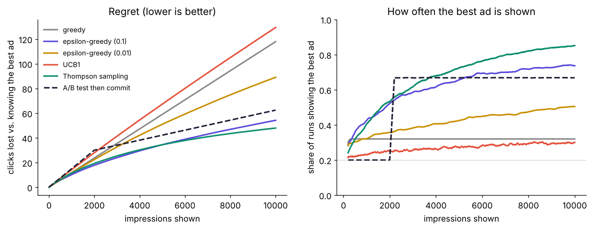
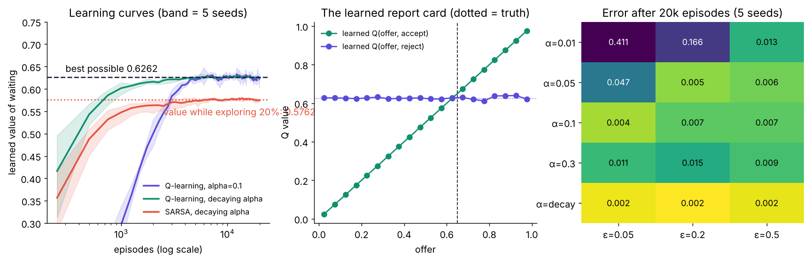
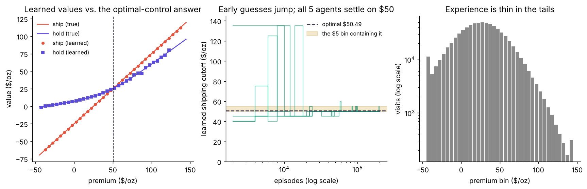

# Reinforcement Learning, From Zero

**QMB 6875 Stochastic Methods · Presentation 2 of 3 · Allie McCutcheon · Fall 2026**

> **Same question as optimal control, but nobody hands you the rules.**
> Try something → get paid → update your estimates → repeat.

Presentation 1 *solved* decision problems because it **knew** the probability model behind them. This repository shows how an agent **learns** the same answers from experience alone, and checks every learned answer against the known optimum.

It ends with the professor's capstone story: the gold trader whose optimal **control-limit policy** was found with reinforcement learning.

| Companion repos | |
|---|---|
| 1. `qmb6875-1-optimal-control` | the rules are known → solve them with math |
| **2. Reinforcement learning** (this repo) | the rules are unknown → learn by trying |
| 3. `qmb6875-3-on-a-computer` | how to actually get the numbers out, and how to trust them |

---

## Three problems, three results

| # | Problem | What the agent learns | Learned | Truth |
|---|---------|-----------------------|---------|-------|
| 1 | **Which of 5 ads to show** (a bandit) | which action pays best, while still earning | Thompson sampling: best ad **85%** of the time, **47.9** clicks lost | best ad = 5% CTR |
| 2 | **Which offers to accept** | $Q$(offer, accept/reject) | value of waiting **0.6260 ± 0.0010** | **0.6262** (exact) |
| 3 | **When the gold trader should ship** | $Q$(premium, ship/hold) | ship from **$50** (all 5 agents) | **$50.49** (optimal control) |

Every number here is written by `scripts/make_figures.py` to [`results/results.json`](results/results.json).

### 1. Bandits: explore vs. exploit, isolated



One state, five ads with unknown click-through rates (2%, 3%, 3.5%, 4%, 5%), 10,000 impressions, averaged over 500 independent experiments.

| Strategy | Clicks lost (regret) | Best ad shown at the end |
|---|---:|---:|
| greedy (never explores) | 117.9 | 32% |
| ε-greedy, ε = 0.01 | 89.0 | 50% |
| ε-greedy, ε = 0.1 | 54.2 | 74% |
| UCB1 | 129.4 | 30% |
| **Thompson sampling** | **47.9** | **85%** |
| A/B test (2,000 impressions) then commit | 62.4 | 67% |

What to notice:
- **Greedy locks onto the wrong ad two-thirds of the time.** Never exploring is the worst mistake.
- **UCB1 over-explores** when rewards are tiny. Its bonus assumes rewards could be anywhere in [0, 1].
- **Thompson sampling** explores exactly as much as its doubt warrants, which is why ad platforms use it.

### 2. The offer problem, learned without knowing offers are uniform



**Q-learning** keeps a report card $Q(s,a)$ and nudges it after every step:

$$Q(s,a)\leftarrow Q(s,a)+\alpha\Big[r+\beta\max_{a'}Q(s',a')-Q(s,a)\Big].$$

- **Left:** with a decaying learning rate, five independent agents converge to the exact answer.
  - **SARSA**, the on-policy cousin, converges to something different on purpose: **0.576**, the value of a policy that keeps exploring 20% of the time.
- **Middle:** the learned report card. "Accept" learns to equal the offer, "reject" learns 0.626, and they cross at the cutoff.
- **Right:** the evidence for the learning settings. Error after 20,000 episodes for every combination of learning rate α and exploration ε (5 seeds each).

### 3. The gold trader learns his own shipping rule



The agent lives through simulated weeks of a premium it knows nothing about, seen in $5 bins. It learns to ship from **$50**, the bin containing optimal control's **$50.49**, and earns **$26.64/oz** vs **$26.59** for the exact rule (statistically identical).

The catch is in the right panel: it needed about **737,000 simulated weeks**, and experience in the tails is thin. **RL is powerful and data-hungry.** Use the math when you know the model; learn when you don't.

---

## How to run it

```bash
git clone https://github.com/ace469089/qmb6875-2-reinforcement-learning.git
cd qmb6875-2-reinforcement-learning
pip install -e . && pip install pytest

pytest                            # 13 tests: learners vs. exact answers (~20 s)
python scripts/make_figures.py    # all figures + results/results.json (~1 min)
python -m rlearn.gold_rl          # any module runs on its own
python -m rlearn.experiments      # the alpha x epsilon evidence table
```

**No install:** open [`notebooks/walkthrough.ipynb`](notebooks/walkthrough.ipynb). It is saved with outputs, so GitHub displays it fully. Colab: File → Open notebook → GitHub → paste the repo URL.

## What's in the repo

```
README.md                ← the 5-minute version
docs/
  THEORY.md              ← the full lesson from zero: MDPs, bandits, Q-learning, SARSA, convergence
  DECISIONS.md           ← every choice (alpha, epsilon, bins, episodes…), why, with evidence
  FAQ.md                 ← questions the professor is likely to ask, answered
  GLOSSARY.md            ← every term in plain English (shared across all three repos)
  PRESENTING.md          ← 15-minute talk plan + 60-second cold-call version
src/rlearn/
  bandit.py              ← greedy, ε-greedy, UCB1, Thompson, A/B test (vectorized over 500 runs)
  offer_rl.py            ← Q-learning + SARSA; exact targets for both
  gold_rl.py             ← market simulator, Q-learning, optimal-control reference, policy evaluation
  experiments.py         ← hyperparameter grid and learning curves
tests/test_rlearn.py     ← 13 tests
scripts/make_figures.py  ← regenerates every figure and number
notebooks/walkthrough.ipynb
figures/  results/
```

## Honest limitations

- **Tabular RL only.** Every state gets its own row in the table. That works for 20 or 38 states; real problems need function approximation (regression or neural networks, i.e. "deep RL"), discussed in THEORY §8.
- **Simulated experience.** The agent learns from a simulator built on the Presentation 1 model, so we can check it. A real application learns from data (the capstone student's records), where no truth is available to check against.
- **Discretized states.** The gold agent sees $5 bins, so it can only learn the cutoff to within $5. Finer bins mean more precision but more experience needed (DECISIONS R2).

## References

- Sutton, R. & Barto, A. *Reinforcement Learning: An Introduction* (2nd ed., 2018). The standard textbook; chapters 2 (bandits) and 6 (Q-learning, SARSA).
- Watkins, C. & Dayan, P. (1992). "Q-learning." *Machine Learning* 8: 279–292 (the convergence proof).
- Auer, P., Cesa-Bianchi, N. & Fischer, P. (2002). "Finite-time analysis of the multiarmed bandit problem." *Machine Learning* 47: 235–256 (UCB1).
- Russo, D. et al. (2018). "A Tutorial on Thompson Sampling." *Foundations and Trends in Machine Learning* 11(1).
